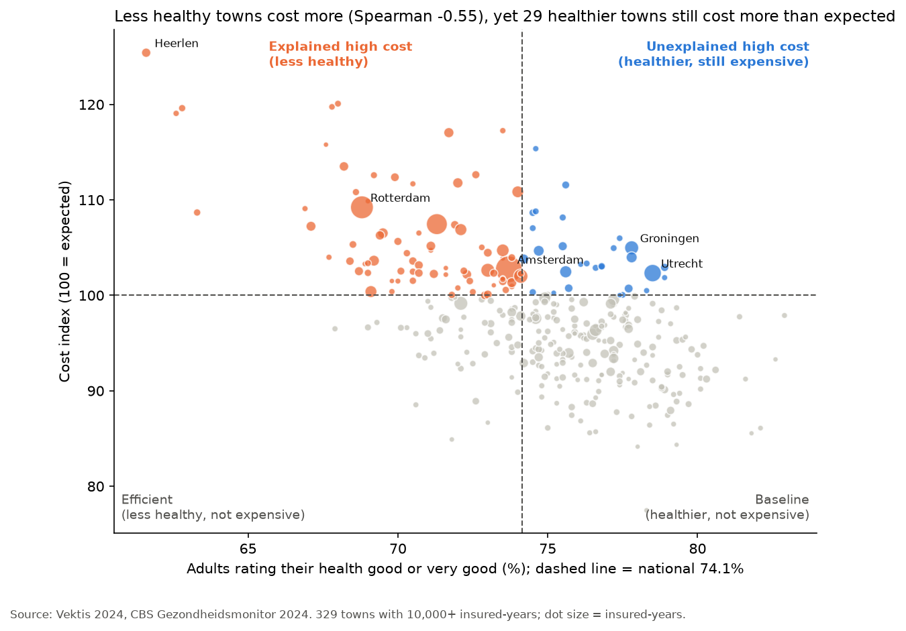
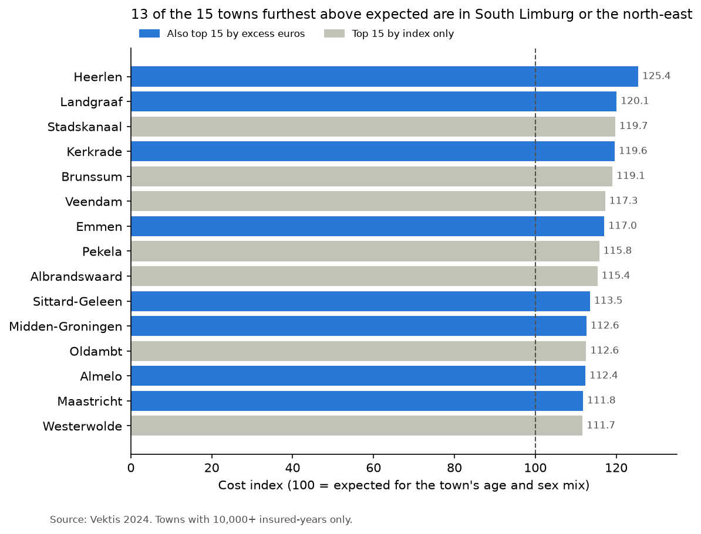
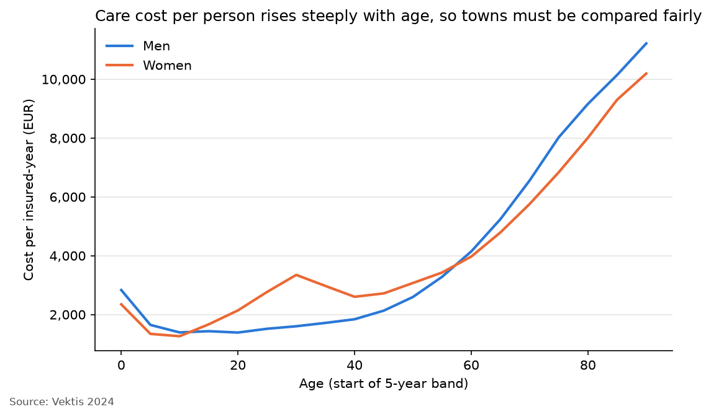
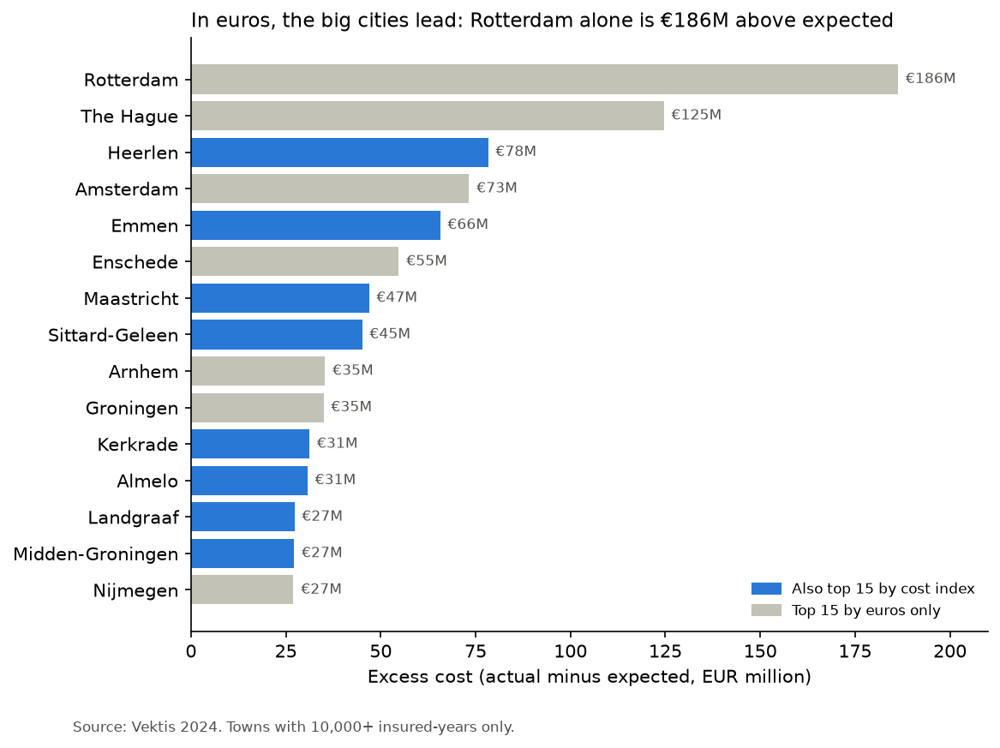
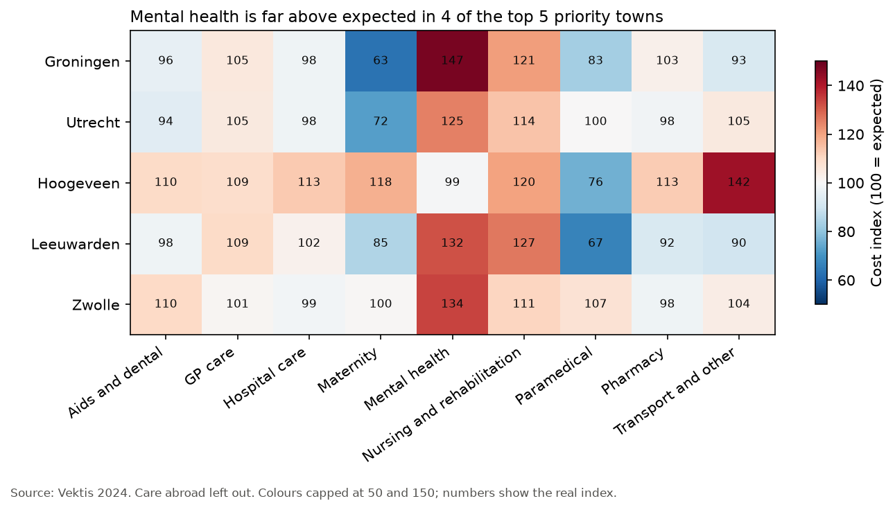

# Health Cost Benchmark: 29 healthier-than-average Dutch towns cost €261M more than expected (2024)

> Fictional stakeholder brief; the data is real and public.

## Executive summary
**What we looked at.** Which of the 342 Dutch municipalities had higher basic-insurance costs per person in 2024 than their age and sex mix predicts, which care types drive the gap, and whether poorer health explains it.

**What we found.** 106 of 329 towns cost more than expected. Most of that extra cost, €1,317M across 77 towns (from Rotterdam and The Hague to most of South Limburg), goes together with poorer health. But 29 towns are healthier than average and still cost €261M more than expected. The 15 largest hold €231M, and mental health is the top driver in 9 of them.

**What we recommend.**
- Start a mental health contract review in Groningen, Utrecht and Zwolle: clearly healthier than average, together €75M above expected.
- Before reviewing Albrandswaard, Renkum and Zutphen, check whether a psychiatric institution in the town explains their extreme mental health costs.
- Treat the towns where poorer health explains the cost, such as Heerlen, as a prevention question, not a contract question.

Above expected is a reason to look, not proof of waste.

## Recommendations
1. **Start a mental health contract and volume review in Groningen, Utrecht and Zwolle.** All three are clearly healthier than national, yet above expected, and mental health is their top driver: Groningen +€39M (index 147), Utrecht +€34M (index 125), Zwolle +€14M (index 134).
2. **Before reviewing Albrandswaard, Renkum and Zutphen, check where their mental health patients are treated.** Their mental health indexes (290, 251, 184) are extreme. Costs count where patients live, so a large psychiatric institution in the town could explain the excess without any overuse.
3. **Review hospital care use and referral patterns in Hoogeveen and Apeldoorn**, as a second wave. Hospital care is their top driver (Hoogeveen index 113, +€14M; Apeldoorn +€11M), but their health is borderline, so part of the gap may still be explained by health.
4. **Review nursing and rehabilitation contracts in Hardenberg and Twenterand.** It is the top driver in both (Hardenberg index 143, +€7M; Twenterand index 161, +€5M), and it is one of the care types where towns differ most.
5. **Do not run a contract review in the 77 towns where poorer health explains the high cost** (+€1,317M, including Heerlen and most of South Limburg). Route them to prevention and health programmes instead.

Above expected is a reason to look, not proof of waste.

## The brief
- **Stakeholder:** Regional Healthcare Strategy Manager at a Dutch health insurer (fictional), responsible for care purchasing and planning.
- **Decision:** which municipalities and care types to prioritise for further investigation or targeted programmes in the next purchasing and planning cycle. The analysis shows *where* spending is unusual, not automatically *why*.
- **Business question:** Which Dutch municipalities had higher basic-insurance costs per person in 2024 than expected for their age and sex mix?
  - Which care types make up most of the extra cost?
  - Is the extra cost larger where residents are less healthy?

## Key charts





## Metric definitions
All costs are basic-insurance (Zvw) claims paid for 2024, per **insured-year**
(one person insured for a full year).

| Metric | Formula | How to read it |
|---|---|---|
| **Actual cost per person** | town's total cost / town's insured-years | Real paid bills, in € |
| **Expected cost per person** | national cost per insured-year for each age-sex group, applied to the town's own age-sex mix | What the town would cost if it were "average" for its population |
| **Excess (€)** | (actual - expected) per person x town's insured-years | Total extra euros; 0 = as expected |
| **Cost index** (headline) | actual / expected x 100 | 100 = as expected; 120 = 20% more than expected |
| **Care-type cost index** | care type's actual / expected x 100, per town | Which care types are far above expected; same scale as the cost index |
| **Care-type excess (€)** | care type's actual - expected, per town | Where the extra euros sit; the top 2 per town are the "drivers" in the priority list |

**Worked example:** a town has 10 young residents (national rate €1,000) and 10 older
residents (national rate €5,000). Expected = (10 x 1,000 + 10 x 5,000) / 20 = **€3,000**
per person. If it actually costs €3,600 per person, the cost index is
3,600 / 3,000 x 100 = **120**.

**Analysis, not a KPI:** is the cost index higher where self-rated health is lower?

## Findings
### 1. Baseline: what does care cost per person?

In 2024, basic insurance paid €59.4 billion for 17.6 million insured-years: **€3,382 per insured-year** nationally. Across towns, actual cost per person ranges from €2,601 (Urk) to €4,520 (Heerlen). Cost rises steeply with age, from about €1,300 a year for 10 to 14 year-olds to €10,500 for people aged 90 and over, roughly eight times more.



### 2. Fair comparison: what should each town cost?

Because age drives cost, raw cost per person mostly shows how old a town is. So each town is compared with its **expected cost**: what it would cost if its residents cost the national rate for their age and sex. Urk, with a young population, is expected to cost €2,721 per person; Bergen (NH) €4,199. Heerlen actually costs €4,520 where €3,604 was expected, a **cost index of 125.4**. Nationally the index is exactly 100 and the total excess €0, which confirms the calculation.

### 3. Where: which towns are furthest above expected?

Towns under 10,000 insured-years are left out of the rankings, because their figures swing too much from a few patients (329 of 342 towns remain). Of these, 106 cost more than expected. The two ways of ranking give different lists:

- **By cost index (%):** the top is mostly South Limburg and the north-east. Heerlen leads at 125.4, followed by Landgraaf (120.1), Stadskanaal (119.7), Kerkrade (119.6) and Brunssum (119.1).
- **By excess (€):** the big cities lead, because a small percentage on a large population is a lot of money. Rotterdam is €186M above expected at an index of only 109.2, The Hague €125M, Amsterdam €73M at just 102.7.
- **On both top-15 lists:** 8 towns, Heerlen, Kerkrade, Landgraaf, Sittard-Geleen, Maastricht, Emmen, Almelo and Midden-Groningen. High in both percentage and euros, they are the strongest signal of where cost sits above expected.

Chart: top 15 by cost index, under Key charts above.



### 4. Why: which care types drive the gap?

For the 8 towns on both top-15 lists, **Hospital care** is the largest driver in euros in 7 of them (Maastricht: Mental health), but with modest indexes of 106 to 119. It is simply the largest care type, so a few percent above expected is many millions. The second driver is Nursing and rehabilitation in Almelo, Emmen, Kerkrade and Landgraaf, Mental health in Heerlen and Sittard-Geleen, and Pharmacy in Midden-Groningen.

- **Where towns really differ:** across the 329 towns, Hospital care and GP care vary least (the middle half of towns sits within about 8 index points). Paramedical, Mental health and Nursing and rehabilitation vary most (26 to 30 points), so this is where a review can find something to act on.
- **Strongest single signal:** Mental health in Heerlen, index 186 and €22.6M above expected, far outside the normal range for that care type.
- **Care abroad** has the highest index in the five Limburg towns (222 to 352) but only €1M to €3M, which reflects hospitals across the German and Belgian border, not something contracts can change.

Drivers are therefore chosen by **euros** (what is at stake), with the **index** as context (what kind of problem it is).

### 5. Explained or not: does poorer health explain it?

Less healthy towns usually cost more: across the 329 towns, the Spearman correlation between self-rated health and cost index is **-0.55**, a strong link. To separate the two, each town is placed in one of four groups by health (above or below the national 74.1% who rate their health good or very good) and cost (index above or below 100):

- **Explained high cost (77 towns, +€1,317M):** less healthy than national and above expected. All 8 towns from Finding 3 are here (Heerlen: 61.6% good health). Here the answer is prevention, not contract review.
- **Unexplained high cost (29 towns, +€261M):** healthier than national, yet above expected. Health does not explain their extra cost, so these are the review targets. None is in Limburg; most are in the north and east, plus Utrecht and Albrandswaard.
- **Baseline (172 towns, -€1,295M):** healthier than national and at or below expected. Nothing to act on.
- **Efficient (51 towns, -€262M):** less healthy, but at or below expected. Either care is well organised or people get less care than they need; the data cannot tell which.

Most of the extra cost, about five times more, is explained by poorer health. Only 9 of the 29 unexplained towns are clearly healthier than national; for the other 20 the survey range overlaps the national figure, so they are borderline. Correlation shows that health and cost move together, not that one causes the other.

Chart: health against cost index, under Key charts above.

### 6. So what: which towns go on the shortlist?

The shortlist starts from the 29 unexplained towns, ranked by excess euros. The top 15 hold about **€231M**, 89% of all unexplained excess (full list: `outputs/priority_list.csv`).

- **Confidence:** 5 towns are *clear* (Groningen, Utrecht, Zwolle, Renkum, Hardenberg; about €89M): even the bottom of their health survey range is above national. They are the strongest review targets, because we can be sure health does not explain their cost. The other 10 are *borderline*: their survey range includes the national figure, so part of their excess may still be explained by health.
- **Drivers:** Mental health is the top driver in 9 of the 15 towns, Hospital care in 4, Nursing and rehabilitation in 2.
- **Start here:** Groningen (+€34.9M), Utrecht (+€24.0M) and Zwolle (+€16.6M). All three are clearly healthier than national, have the largest excess among the clear towns, and are driven by mental health.
- **Check first:** Albrandswaard, Renkum and Zutphen have extreme mental health indexes (290, 251, 184). Costs count where patients live, so a large mental health institution in the town could explain this; check that before any contract review.
- **Not on the list, on purpose:** the 8 towns from Finding 3. Their high cost is explained by poorer health, so they need prevention, not contract review.



## Priority list

The top 10 of the 15 priority towns. Full list with the second driver and a suggested focus per town: [`outputs/priority_list.csv`](outputs/priority_list.csv).

| # | Municipality | Cost index | Excess | Confidence | Top driver |
|---|---|---|---|---|---|
| 1 | Groningen | 105.0 | +€34.9M | clear | Mental health |
| 2 | Utrecht | 102.3 | +€24.0M | clear | Mental health |
| 3 | Hoogeveen | 111.6 | +€22.4M | borderline | Hospital care |
| 4 | Leeuwarden | 104.7 | +€19.3M | borderline | Mental health |
| 5 | Zwolle | 104.0 | +€16.6M | clear | Mental health |
| 6 | Zutphen | 108.7 | +€15.0M | borderline | Mental health |
| 7 | Hengelo | 105.1 | +€14.3M | borderline | Hospital care |
| 8 | Apeldoorn | 102.5 | +€14.1M | borderline | Hospital care |
| 9 | Albrandswaard | 115.4 | +€13.4M | borderline | Mental health |
| 10 | Deventer | 103.8 | +€12.9M | borderline | Mental health |

## Data sources
1. **Vektis Open Databestand Zorgverzekeringswet 2024 - gemeente.**
   Basic-insurance (Zvw) costs for 2024, split into 26 care types, per municipality, sex and five-year age band, with insured people and insured-years.
   12,992 rows x 31 columns, semicolon-separated CSV.
   
   Link: [Vektis open databestanden](https://www.vektis.nl/zorgprisma/open-databestanden)
   
   Documentation: Vektis bijsluiter (leaflet) 2011-2024.
   
   Credit: bron: Vektis. Free for personal and research use; no commercial use.
2. **CBS Gezondheidsmonitor 2024, table 86137NED.**
   Health survey results for adults (18+) per municipality, with 95% margins.
   
   Used: self-rated health (% good or very good).
   
   Link: [CBS StatLine 86137NED](https://opendata.cbs.nl/statline/#/CBS/nl/dataset/86137NED/table), accessed through the CBS open data API.
   
   Credit: Bron: GGD'en, RIVM en CBS.

**Why 2024.** It is the most recent year Vektis publishes (checked November 2026; the next file is announced for mid-2027), because claims for a year keep arriving and being settled for months after it ends. The CBS Gezondheidsmonitor covers the same year, so cost and health describe the same period. Which towns cost more than expected changes slowly, so two-year-old data still answers the purchasing question.

## Health measure
**Self-rated health** (% of adults who rate their health as good or very good; higher = healthier). I chose it because it covers all kinds of health, so it matches total cost, the headline KPI. 
Anxiety or depression was set aside: it explains only the mental health slice, and specialist mental health costs are only about 90% complete in the Vektis data.

## Method
1. **Acquire.** The Vektis file is downloaded by hand (Vektis blocks scripts); the CBS health table comes from the CBS open data API, with pagination. `pipeline.py` rebuilds both from nothing.
2. **Clean.** Nine documented decisions (see Cleaning decisions), each checked with asserts, give one clean row per municipality, sex and age band, with a CBS code on every row.
3. **Benchmark, by indirect standardisation.** National cost per insured-year for 38 sex and age groups; each town's expected cost = its insured-years in each group x those national rates. Cost index = actual / expected x 100; excess = actual - expected. Checksums: the country comes out at exactly 100 and €0.
4. **Drivers.** The same calculation for each of 10 care-type groups. Drivers are ranked by excess euros, with the index and the spread across towns (IQR) as context.
5. **Health.** Towns under 10,000 insured-years are left out of rankings (329 remain). Spearman correlation between self-rated health and cost index, then four segments by health (above or below the national 74.1%) and cost (above or below 100).
6. **Priority list.** The "unexplained high cost" towns ranked by excess euros, top 15 kept, each with a confidence label from the 95% survey range, its two largest drivers and a hand-written suggested focus.

## Cleaning decisions
Every decision is written out in full (found, did, why, rejected) in `notebooks/02_clean.ipynb`. `pipeline.py` runs the decided steps; one command, `python pipeline.py`, rebuilds the clean tables, the analysis and the priority list from the raw data.


- **Privacy bucket removed.** One unlabelled row holds groups under 10 people and people with unknown sex, age or municipality: 2.2% of people but 0.3% of cost. It cannot be placed in any municipality.
- **Negative cells kept.** 2 of about 338,000 cells (Uitgeest, Twenterand), each under 0.01% of that town's cost. They are real corrections, and keeping them keeps totals equal to the official Vektis figures.
- **Care abroad kept.** 0.6% of all cost, but 18% in Sluis and 5 to 10% in other border towns. Excluding it would make those towns look cheaper than they are.
- **Age band as a number.** `age_from` (0, 5 ... 90), so age bands sort correctly.
- **10 care-type groups.** The 26 Vektis cost columns are mapped to 10 groups in `data/manual/care_type_groups.csv`. An assert checks the groups add up to the total in every row.
- **Name matching.** Vektis has only names, CBS has codes. A matching key (capitals, accents removed) matched 329 of 342; the other 13 are fixed by hand in `data/manual/name_fixes.csv`. Asserts check every row has a code.
- **Boundaries.** Vektis and CBS cover exactly the same 342 municipalities (2024 layout), checked by an assert.
- **CBS reshaped.** Adults (18+) and self-rated health only, one row per municipality, with the value and its 95% interval (`health_value`, `health_low`, `health_high`).
- **Missing health values kept empty.** Schiermonnikoog and Vlieland have no health figure. They stay in the cost benchmark and are left out only of the cost-versus-health comparison.

## Limitations
**What the data covers**
- Vektis covers basic insurance (Zvw) only: no long-term care (Wlz), no supplementary insurance, no out-of-pocket care. It is all insurers combined, not one insurer's own book.
- CBS health covers adults (18+) in private households only, so children and nursing-home residents are missing from the health measure, while Vektis cost covers everyone.
- Specialist mental health costs are only about 90% complete in the Vektis data. Mental health is the main driver on the priority list, so its excess may be somewhat understated.
- Care abroad is incomplete (foreign bills arrive late), so border towns' true cost is probably higher than shown.
- One year only (2024): a one-year spike cannot be told apart from a lasting pattern.

**What the method can and cannot say**
- Age and sex are not the only reasons people need care. The insurers' official risk-equalisation model (*risicoverevening*) also adjusts for diagnoses, income and more, so some "unexplained" gaps would shrink under that model.
- Above expected is not the same as overspending: it can reflect a nearby academic hospital, better access, or sicker residents in ways a survey misses. Costs also count where patients live, so a large institution in a town raises that town's figures.
- Area-level patterns say nothing about individuals (the [ecological fallacy](https://en.wikipedia.org/wiki/Ecological_fallacy)). Correlation shows that health and cost move together, not that one causes the other.
- Health figures are survey estimates with a 95% range. Small municipalities have wide ranges, so an extreme value there may be noise; this is why 10 of the 15 priority towns are labelled borderline.
- Small municipalities are volatile, so the 13 towns under 10,000 insured-years are left out of rankings and segments.

**My own choices**
- Negative cells and care abroad are kept, and the 26 cost columns are grouped into 10 care types by judgment (see Cleaning decisions).
- Schiermonnikoog and Vlieland have no health figure, so they are not in the cost-versus-health comparison.
- The suggested focus per town is a judgment call, not a result from the data; a domain expert at the insurer should review it.

## How to reproduce

Tested with Python 3.13 on macOS. You need internet access for the CBS download.

1. **Clone the repo and set up a virtual environment.**
   ```bash
   git clone https://github.com/FaraRahimi/health-cost-benchmark.git
   cd health-cost-benchmark
   python3 -m venv .venv
   source .venv/bin/activate
   pip install -r requirements.txt
   ```
2. **Download the Vektis file by hand.** Vektis blocks scripted downloads, so this is
   the one manual step. Download
   [Vektis Open Databestand Zorgverzekeringswet 2024 - gemeente](https://www.vektis.nl/vektisnl-assets/prd/storage/uploads/Docs%20per%20pagina/Open%20Data%20Bestanden/2024/Vektis%20Open%20Databestand%20Zorgverzekeringswet%202024%20-%20gemeente.csv)
   and save it, with its name unchanged, as
   `data/raw/Vektis Open Databestand Zorgverzekeringswet 2024 - gemeente.csv`.
   If the file is missing, `pipeline.py` stops and prints these same instructions.
3. **Run the pipeline, then the charts.**
   ```bash
   python pipeline.py
   python charts.py
   ```
   `pipeline.py` downloads the two CBS tables into `data/raw/` (skipped if they are
   already there), cleans both sources, runs the benchmark and saves the priority list.
   Every step checks itself with asserts, so a wrong number stops the run instead of
   reaching the results.

**What you get:** `outputs/priority_list.csv` (the 15 priority municipalities) and five
charts in `figures/`. The notebooks in `notebooks/` show the same steps with every
decision explained; they read the files the pipeline makes, so run the pipeline first.

## Project structure

| Path | What it holds | Made by |
|---|---|---|
| `pipeline.py` | Download, clean and analyse; saves the priority list | hand |
| `charts.py` | The five charts, one function each | hand |
| `notebooks/01_explore.ipynb` | First look at the raw data | hand |
| `notebooks/02_clean.ipynb` | Every cleaning decision: found, did, why | hand |
| `notebooks/03_analyse.ipynb` | The benchmark step by step, with findings | hand |
| `data/raw/` | Vektis and CBS source files (not in git) | you (Vektis) and the pipeline (CBS) |
| `data/manual/` | Hand-made inputs: care-type groups, name fixes, suggested focus per town | hand |
| `data/processed/` | Clean and analysis tables (not in git) | the pipeline |
| `outputs/priority_list.csv` | The deliverable: 15 municipalities to review | the pipeline |
| `figures/` | The five charts as PNG | `charts.py` |
